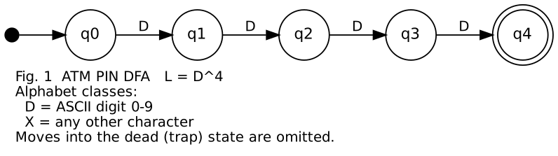
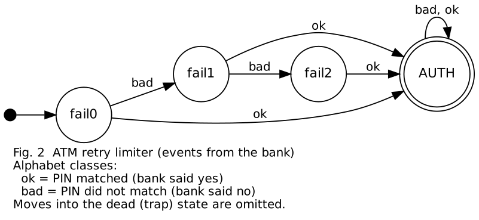
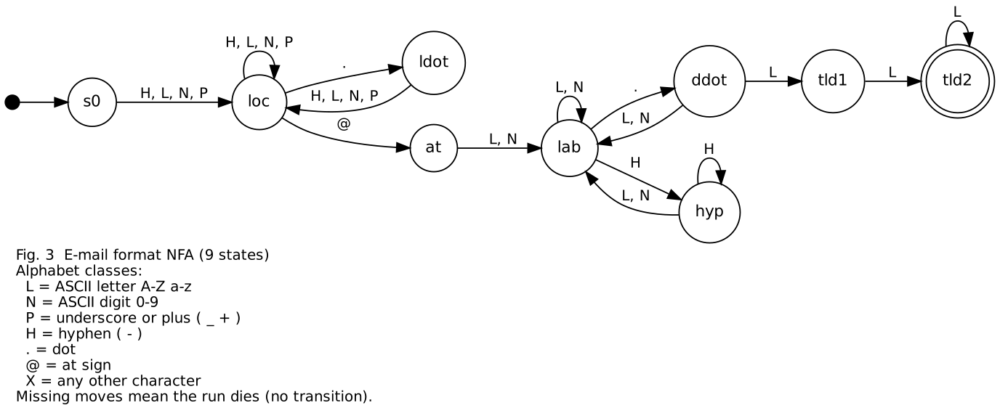
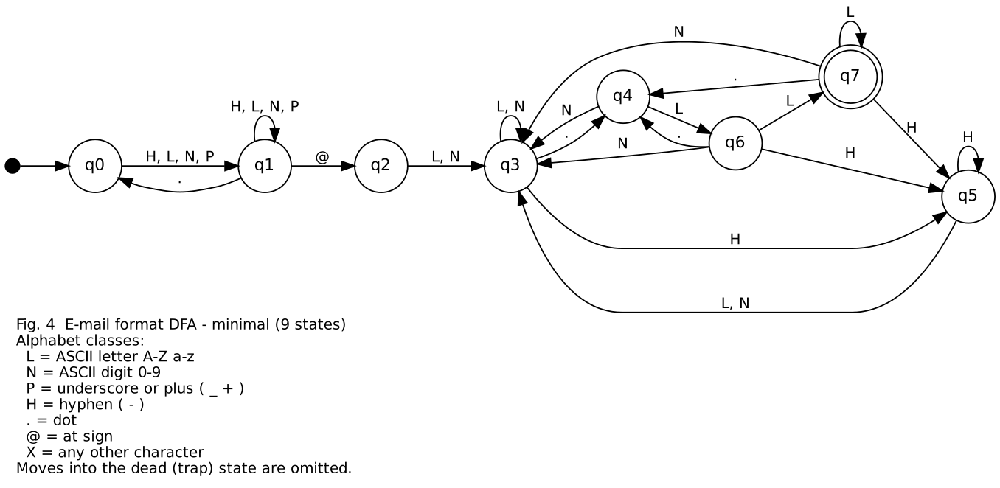
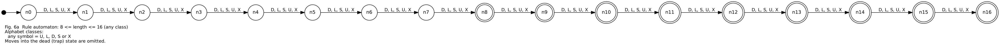
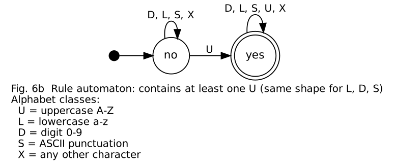
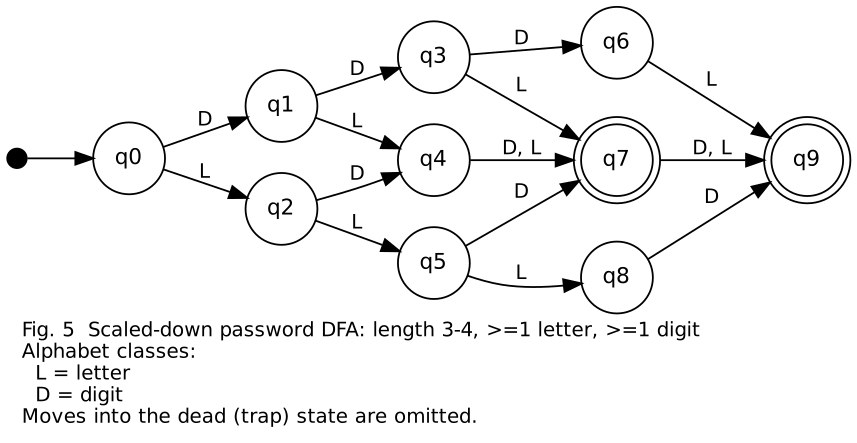

# Task 2: Designing Automata for Real-Time Applications

**Course:** 21CSC301T Formal Language and Automata  |  **CLA-2, Assessment Task 2**  |  **SDG 9** (Industry, Innovation and Infrastructure), Level 2: Design Alignment
**Student:** `MULKA AKANKSHA` · `RA2411026050017` · B.Tech AIML, Semester V
**Repository role:** this repo is the Task 2 deliverable (design note + code + demonstration evidence).

---

## 1. What this project does

Three validators are modelled as **finite automata**, drawn, implemented in Python, and tested:

| # | Application | Automaton | Alphabet Σ | States (minimal) |
|---|---|---|---|---|
| 1 | ATM PIN verification | DFA (+ a retry-limiter DFA) | {D, X} | 6 (+5 for the limiter) |
| 2 | E-mail format validation | NFA → DFA by subset construction → minimised | {L, N, P, H, ., @, X} | NFA 9, DFA 9 |
| 3 | Password policy verification | two DFA designs, proved equivalent | {U, L, D, S, X} | 197 |

Everything is built on a small hand-written DFA/NFA toolkit (`automata/`): running and tracing a machine, subset construction, product (intersection), Moore minimisation, equivalence checking with a shortest counter-example, and Graphviz export. No third-party libraries are needed to run the validators (`pytest` is only for the tests, Graphviz only to redraw the figures).

### Repository layout

```
automata/        dfa.py, nfa.py     the toolkit (run, trace, minimise, intersect, subset construction, DOT export)
validators/      pin.py, email.py, password.py     the three applications
tests/           cases.json (listed accept/reject strings), test_validators.py (26 tests)
demo.py          command-line demonstration with state traces
tools/           generate_diagrams.py     regenerates diagrams/ and docs/design_stats.md
diagrams/        *.dot (source), *.png, *.svg
docs/            demo_output.txt (full demonstration log), design_stats.md (all transition tables, state counts)
```

### Run it

```bash
python demo.py                          # every listed case, with the state path (this is docs/demo_output.txt)
python demo.py --pin 4821               # one value
python demo.py --email student@srmist.edu.in
python demo.py --password 'Passw0rd!'
python demo.py --retry bad bad ok       # ATM retry limiter (events)
python demo.py -i                       # interactive mode
pip install pytest && python -m pytest  # 26 tests
python tools/generate_diagrams.py       # redraw figures (needs Graphviz `dot`)
```

---

## 2. Syntax rules vs. semantic (business) rules

A finite automaton reads the input once, left to right, with a **fixed, finite amount of memory** (its current state). So it can check **syntax**, meaning the shape of the string, but nothing that needs outside knowledge.

| Application | Syntax rule: a DFA is enough | Semantic / business rule: needs extra processing |
|---|---|---|
| ATM PIN | exactly 4 ASCII digits | does the PIN match *this card's* PIN (bank database); is the card blocked; is `0000`/`1234` forbidden by policy |
| E-mail | `local@domain.tld` shape, dot and hyphen placement, TLD of 2+ letters | does the mailbox or domain exist (DNS / SMTP), is the TLD on the public list, is the address verified by a confirmation mail |
| Password | length 8-16, all four character classes, no illegal characters | is it in a breached-password list, is it equal to the username or the previous password, does the user's account policy allow it |

**A finite automaton is sufficient** when the rule is *regular*: it can be decided by remembering a bounded summary of what has been read (a counter up to a constant, a few flags, "last character was a dot"). All three syntax rules above are of this kind.
**It is not sufficient** when the decision needs unbounded memory (balanced nesting, matching `a^n b^n`, which is the subject of Task 3) or **information outside the string** (a database, the network, another input such as the username).
Two practical benefits of the DFA approach (these are what tie the work to SDG 9, reliable and efficient digital infrastructure): a DFA runs in **O(n) time and O(1) extra memory**, which suits ATMs and embedded devices, and it has **no backtracking**, so it cannot suffer the catastrophic-backtracking (ReDoS) slowdowns that some regular-expression engines have.

**Convention used in all diagrams.** Each DFA is total. A non-accepting *dead* state absorbs every input that can no longer be completed into a valid string. To keep figures readable, **moves into the dead state are not drawn**; any move that is missing from a figure goes to `dead`. The full tables, dead state included, are in `docs/design_stats.md`.

---

## 3. Application 1: ATM PIN verification

### Language and assumptions
* Σ = {**D**, **X**}, where D is an ASCII digit `0-9` and X is any other character (letters, space, punctuation, newline, non-ASCII digits such as `١٢٣٤`).
* **L_PIN = D⁴** (exactly four digits). Leading zeros are allowed (`0007` is a valid PIN).
* A variant for banks with 6-digit PINs is the same machine with two more states (`PIN6_DFA` in `validators/pin.py`).

### Automaton


| State | Meaning |
|---|---|
| q0 | start, no digit read yet |
| q1, q2, q3 | 1, 2, 3 digits read so far |
| q4 (accepting) | exactly 4 digits read |
| dead | a non-digit was read, or a 5th digit arrived |

**Transitions.** `δ(qi, D) = q(i+1)` for i < 4; `δ(q4, D) = dead` (a fifth digit is one too many); `δ(qi, X) = dead` for every state. The machine is already minimal (6 states including `dead`), as the minimiser confirms.

### Test cases (all executed by `tests/test_validators.py`)

**Accepted (8):** `0000`, `1234`, `4821`, `9999`, `0007`, `5050`, `7391`, `0420`

| Rejected string | Why |
|---|---|
| `123` | too short (3 digits) |
| `12345` | too long (5 digits) |
| `""` (empty) | empty input |
| `12a4` | contains a letter |
| `12 4` | contains a space |
| `12.4` | contains a dot |
| `-123` | contains a minus sign |
| `1234` + newline | the newline is not a digit; a classic regex-`$` pitfall that the DFA does not have |
| `١٢٣٤` | non-ASCII digits; the alphabet is ASCII 0-9 only |

### The ATM session: where the DFA ends and the bank begins
The PIN DFA only says "this *looks like* a PIN". Whether it is the **right** PIN is a database lookup, so a second automaton models the session control flow *around* that lookup. Its input alphabet is the **events** `ok` / `bad` that the bank's back-end reports.



`L = { bad^k · ok · w : k ≤ 2, w ∈ {ok, bad}* }`: authentication succeeds if `ok` arrives before the third `bad`; three `bad` events lock the card (`LOCKED` is absorbing).
`python demo.py --retry bad bad bad ok` shows `fail0 → fail1 → fail2 → LOCKED → LOCKED`, i.e. not authenticated even though the last attempt was correct.

### Limitations
* Syntax only: a correct-looking but wrong PIN is accepted by the DFA; matching needs the bank.
* Weak PINs (`0000`, `1234`, a birth year) pass the syntax check. Forbidding a *finite list* is technically regular, but a lookup table is the sane implementation, so it is treated as policy, not syntax.
* The retry limiter assumes the counter resets on a new session and that failures are consecutive; real systems add time windows and fraud rules.

---

## 4. Application 2: E-mail format validation

### Language and assumptions
This is a deliberately **simplified subset of RFC 5322** (the full standard allows quoted strings, comments and IP-literal domains, which are out of scope).

* Σ = {**L** letter, **N** digit, **P** `_` or `+`, **H** `-`, **.**, **@**, **X** anything else}.
* Written as a regular expression over characters:

```
word   = [A-Za-z0-9_+-]+
local  = word ( . word )*                  no leading, trailing or doubled dot
label  = alnum ( [alnum-]* alnum )?        a label may not start or end with '-'
domain = ( label . )+ [A-Za-z]{2,}         at least one dot; TLD = 2 or more letters
email  = local @ domain
```
* Assumptions: ASCII only (no internationalised addresses), no length limits (64/254 are regular but would blow up the state count without adding insight), TLD letters only (this excludes punycode TLDs such as `xn--…`).

### Why an NFA first?
After a dot in the domain, a letter could be the start of **another ordinary label** (`example.co.uk`) *or* the first letter of the **final TLD** (`example.co`). The machine cannot know which until the string ends. An NFA expresses this naturally: state `ddot` on `L` goes to **both** `lab` and `tld1`.



### NFA → DFA (subset construction) → minimal DFA
* The subset construction yields **10** DFA states (9 NFA subsets reachable + `dead`); the interesting ones are `{lab,tld1}` (a letter after a dot: label or TLD?) and `{lab,tld2}` (accepting: it could still be a label or already be a valid TLD).
* Minimisation finds exactly **one** merge: `s0` (start) and `ldot` (just after a dot in the local part) have identical futures, because both demand one local-part character next. The result has **9 states** (8 live + `dead`).



| Minimal state | Meaning (NFA states it stands for) |
|---|---|
| q0 | start, or just after a dot in the local part: a local character is required next (`s0` ≡ `ldot`) |
| q1 | inside the local part (`loc`); `.` returns to q0, `@` moves on |
| q2 | just read `@`: first domain character must be a letter or digit (`at`) |
| q3 | inside a domain label that ends in a letter or digit (`lab`) |
| q4 | just read a `.` in the domain (`ddot`) |
| q5 | the label so far ends in `-` (`hyp`): a letter or digit must follow |
| q6 | `{lab, tld1}`: one letter after a dot; not accepting, the TLD needs 2 letters |
| q7 (accepting) | `{lab, tld2}`: two or more letters after the last dot |

Both transition tables (NFA, subset DFA, minimal DFA) are in `docs/design_stats.md`.

### Test cases

**Accepted (8):** `student@srmist.edu.in`, `john.doe@example.com`, `a_b+tag@mail.co`, `x@y.io`, `first-last@sub.domain.org`, `user123@site-name.net`, `A.B.C@d.ee`, `no-reply@a1.b2.example.org`

| Rejected string | Why |
|---|---|
| `plainaddress` | no `@` |
| `@example.com` | empty local part |
| `user@` | empty domain |
| `user@domain` | domain has no dot |
| `user@@example.com` | two `@` signs |
| `.user@example.com` | local part starts with a dot |
| `user.@example.com` | local part ends with a dot |
| `us..er@example.com` | two consecutive dots |
| `user@-example.com` | domain label starts with a hyphen |
| `user@example-.com` | domain label ends with a hyphen |
| `user@example.c` | TLD has only 1 letter |
| `user@example.c0m` | TLD contains a digit |
| `user name@example.com` | space in local part |
| `user@exa mple.com` | space in domain |
| `user@.example.com` | domain label is empty |

Worked trace of `x@y.io` (minimal DFA): `q0 -L→ q1 -@→ q2 -L→ q3 -.→ q4 -L→ q6 -L→ q7` → **accept**.
Trace of `a@b.c`: `… -.→ q4 -L→ q6`; input ends in a non-accepting state → **reject** (one-letter TLD). Run `python demo.py --email a@b.c` to see the explanation text.

### Limitations
* **Format only.** `nobody@srmist.edu.in` is accepted although the mailbox may not exist; existence needs DNS/SMTP or a confirmation e-mail.
* The grammar is a subset of the real standard, so some legal addresses are rejected (quoted local parts, `user@[192.168.0.1]`, internationalised domains) and no deliberately obscure ones are accepted.
* Length limits and the list of real TLDs are not enforced (see assumptions).

---

## 5. Application 3: Password policy verification

### Language and assumptions
* Σ = {**U** `A-Z`, **L** `a-z`, **D** `0-9`, **S** ASCII punctuation (32 symbols), **X** anything else, including space, control and non-ASCII characters}.
* Policy: **8 ≤ length ≤ 16**, **at least one of each of U, L, D, S**, and **no X**.
* Every one of these conditions is regular, so one DFA decides the whole policy.

### Two designs, compared

**Design A: one purpose-built DFA.** The state is `(n, seen)`: *n* characters read so far (0..16) and the set of classes seen. Example: `(5,UL)` = five characters read, an uppercase and a lowercase letter seen so far. Reading X, or any character at `n = 16`, goes to `dead`. Accepting: `8 ≤ n ≤ 16` and all four classes seen.

**Design B: product of small rule automata.** One tiny DFA per rule (length 8..16, contains U, contains L, contains D, contains S, no X), combined with the **product construction** (intersection).




| | Design A (direct) | Design B (product) |
|---|---|---|
| States | 225 | 479 |
| After minimisation | **197** | **197** |
| Equivalent? | `A.counterexample(B)` returns `None`: **no string is accepted by one and rejected by the other** | |
| Easier to read/verify | medium | **high**: each rule is a 2-state or 18-state machine you can check by eye |
| Easier to change a rule | medium | **high**: add or remove one small DFA |
| Hand-drawable | no | no (but the *parts* are) |

**Why 225 → 197?** Design A has 224 reachable `(n, seen)` pairs plus `dead`. Exactly **28** of those pairs are *doomed*: not enough characters are left to collect the missing classes (for example `(16, UL)`, or `(15, U)`, which needs three more classes but has one slot left). They can never reach acceptance, so they behave like `dead` and are merged into it. That 28 = 14 + 10 + 4 (counting at n = 16, 15, 14) matches 225 − 197 exactly. Design B, built from independent parts, carries a lot more redundancy (479 states) but minimises to the same 197-state machine, as it must, because the minimal DFA of a regular language is unique.

A 197-state machine cannot be drawn legibly, so **Fig. 5** shows the *same construction* on a scaled-down policy (letters/digits only, length 3-4, at least one letter and one digit). It minimises to 11 states (10 live + `dead`). Reading left to right, the states track how many characters have been read and which classes have appeared; the accepting states are `q7` (3 characters, both classes seen) and `q9` (4 characters, both classes seen).



### Test cases

**Accepted (8):** `Passw0rd!`, `Abcdef1@`, `Srm#2026Fla`, `Zx9$Zx9$Zx9$Zx9$` (16, the maximum), `N0t-So_Secret!`, `Tr1cky&Long#Pw`, `aB3$aB3$` (8, the minimum), `Hello-World-2026`

| Rejected string | Why |
|---|---|
| `password` | no uppercase, digit or special character |
| `PASSWORD1!` | no lowercase letter |
| `Pass1!` | too short (6 characters) |
| `Passw0rd` | no special character |
| `Passw0rd!Passw0rd!` | too long (18 characters) |
| `Zx9$Zx9$Zx9$Zx9$A` | too long (17 characters, one over the limit) |
| `Pass word1!` | contains a space |
| `Password!!` | no digit |
| `passw0rd!` | no uppercase letter |
| `""` (empty) | empty input |
| `Passw0rd!é` | non-ASCII character |
| `Abcdef1` | 7 characters (one under the minimum) and no special character |

### Limitations
* **Policy compliance is not password strength.** `Passw0rd!` satisfies every rule above and is still a terrible password. Checking it against breached/common-password lists, the username, or the user's previous passwords needs a dictionary, another input or an external service, which is semantic checking.
* "No more than two identical characters in a row" or "no username inside the password" can be encoded in a DFA only by multiplying the state count (and the username one depends on a second, unbounded input), so they are better done in ordinary code after the DFA.
* The DFA answers yes/no. It does not tell the user *which* rule failed; that is why the demo also reports where the run entered the dead state.

---

## 6. Validation evidence

`python -m pytest`: **26 tests, all passing.**

| Layer | What it proves |
|---|---|
| Listed cases (`tests/cases.json`) | every accepted string is accepted and every rejected string is rejected: PIN 8 / 9, e-mail 8 / 15, password 8 / 12 |
| **Exhaustive** comparison with an independent oracle (Python `re` / plain predicates) | **every** class string up to length 7 (PIN, e-mail) or 8 (password) gets the same answer from the DFA and the oracle: 255 PIN strings, **960,800** e-mail strings, **488,281** password strings |
| Seeded random / mutation tests on real characters | 20,000 PIN strings, 40,000 e-mail strings (valid by construction, then mutated), 30,000 password strings; the e-mail and password samples are asserted to contain >1,000 accepts and >1,000 rejects each, so both outcomes are really exercised |
| Structural checks | NFA, subset DFA and minimal DFA agree on all strings up to length 6; password Designs A and B are equivalent; PIN is minimal (6 states); retry limiter locks after 3 failures; length boundaries 7/8/16/17 |

The full state-by-state log of the demonstration is in **`docs/demo_output.txt`**.

---

## 7. Suggested 5-minute demonstration

1. **(1 min)** Open Fig. 1 and Fig. 2; run `python demo.py --pin 4821` and `--pin 12a4`. Point at the state path and the "entered the dead state at character 3" message.
2. **(1.5 min)** Show the e-mail NFA (Fig. 3): explain the nondeterministic `ddot` state, then the subset DFA and the single merge. Run `python demo.py --email x@y.io` and `--email a@b.c`.
3. **(1.5 min)** Show Design A vs B for the password and the "A ≡ B" equivalence result; explain 225 → 197 (28 doomed states).
4. **(1 min)** Limitations: the Section 2 table (syntax vs semantic) and when a DFA is not enough (leads into the PDA/CFG work in Task 3).

---

## 8. Rubric map

| Rubric criterion | Where it is addressed |
|---|---|
| Problem understanding and formal model | each application's *Language and assumptions* block (Σ, L, assumptions) |
| Correctness and technique selection | DFA / NFA diagrams, transition tables, test cases; NFA chosen where the nondeterminism is natural |
| Depth of formal analysis | subset construction, minimisation, product construction, A ≡ B proof, doomed-state count |
| Quality of insights and validation | syntax-vs-semantic table, limitations per application, exhaustive and random testing |
| Report and communication | this design note, figures, `docs/demo_output.txt`, demo plan |

## 9. References

1. J. E. Hopcroft, R. Motwani, J. D. Ullman, *Introduction to Automata Theory, Languages, and Computation*, 3rd ed., Pearson, 2006 (DFA/NFA, subset construction, minimisation, product construction).
2. M. Sipser, *Introduction to the Theory of Computation*, 3rd ed., Cengage, 2013.
3. P. Resnick, *RFC 5322: Internet Message Format*, IETF, 2008 (the full e-mail address grammar that Section 4 simplifies).
4. Graphviz, https://graphviz.org (diagram rendering).
5. United Nations SDG 9: Industry, Innovation and Infrastructure, https://sdgs.un.org/goals/goal9
